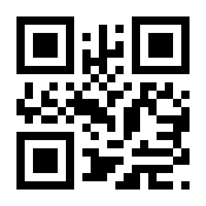

# Encoded Name Tag

The display on the micro:bit is a two-dimensional matrix of LEDs arranged in 5 columns by 5 rows (5x5 matrix). A QR code that we commonly see is a type of barcode that has information encoded into dots in a two-dimensional matrix. We can make our own matrix code and display it on the micro:bit's LEDs. Even though we can't make a code as complex as a QR code, we can take at least 5 letters of the alphabet and create an encoded pattern for them and display it using the LEDs as the dots in the coded matrix.

<MoreInfo title="Goals for this activity...">

Learn how to encode text characters into a custom 5x5 binary LED grid array on the BBC micro:bit and deploy it using MakeCode blocks.

## 1. Introduction & Objectives
Briefly explain the goal of the project: creating a badge that scrolls or blinks a personalized name tag using custom grid rules.
*   **Concepts:** Binary mapping, coordinates, loops, and LED arrays.
*   **Requirements:** A BBC micro:bit (V1 or V2) and a USB micro cable.

## 2. Design the 5x5 Matrix Layout
This is where we explain how the grid maps out text. We will drop your custom image component right here to illustrate the grid logic.

<ImageFigure 
  src="/images/matrix-grid-blueprint.png" 
  caption="The 5x5 LED array coordinate map for character styling blocks." 
  width="450px" 
/>

## 3. Step-by-Step MakeCode Programming
Clear, bite-sized instructional fragments mapping out how to build the block code sequence:
1. Open the MakeCode editor.
2. Initialize the `on start` container block.
3. Inject a `show leds` grid pattern to draw the initial boundaries.
4. Establish an index loop tracking your character sequence variables.

## 4. Testing & Extension Activities
How to verify the program is working on the device and edge cases to look out for.
*   **Verification:** Ensure characters render without clipping text boundaries.
*   **Extension:** Use the micro:bit's internal accelerometer to speed up the text scroll speed when the device is shaken.

</MoreInfo>

## Encoding a message

